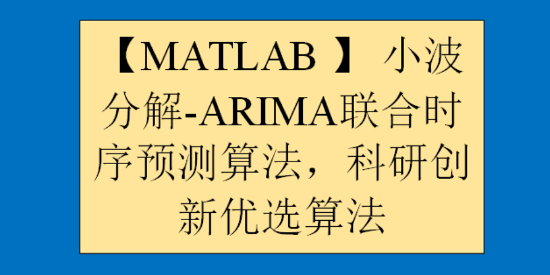

# MATLAB ] Wavelet Decomposition - ARIMA Joint Time Series Forecasting Algorithm, Preferred Research and Innovation Algorithm

Interested in obtaining the code? Please refer to the end of this message for the method of obtaining the code.
1 Wavelet Decomposition Algorithm: A wavelet decomposition algorithm is a mathematical method used to decompose signals into different frequency components represented by wavelets. This algorithm is based on wavelet functions and can be applied in signal processing, image compression, and data compression fields. The basic idea of the wavelet decomposition algorithm is to decompose a signal into multiple wavelet subbands, each representing a different frequency component of the wavelet. These wavelet subbands can be processed separately, such as filtering or down-sampling, before reconstruction to obtain the original signal. The advantage of wavelet decomposition algorithms is that they provide better time-frequency resolution, which results in better performance for transient signals and non-stationary signals. Additionally, wavelet decomposition algorithms can be used for image compression and data compression because the subbands after decomposition can selectively retain or discard, thereby achieving data compression. In summary, wavelet decomposition algorithms are a powerful signal processing technique widely applied in signal processing, image compression, and data compression fields.
MATLAB Signal Decomposition Volume 6 - Wavelet Decomposition:
For detailed information about signal decomposition, please refer to:
2. ARIMA Time Series Forecasting Algorithm
The ARIMA (Autoregressive Integrated Moving Average) model is a predictive model based on time series analysis, suitable for analyzing and forecasting data with both temporal dependence and randomness. The ARIMA model was first proposed by Box and Jenkins in 1976 and has since become a widely used time series model for data prediction in production and finance sectors. The core idea of the ARIMA model is to decompose the time series data through differencing, making the sequence stationary, and then establish the model through the combination of autoregression (AR) and moving average (MA), using this model for forecasting. In the ARIMA model, "AR" stands for autoregression, indicating that current data are related to previous moments of data; "I" stands for differencing, which means to make the data stationary through differencing; "MA" stands for moving average, indicating that current data are related to errors from previous moments.
The establishment process of the ARIMA model includes three steps: model identification, parameter estimation, and model verification. In the model identification phase, it is necessary to determine the order of the ARIMA model and the number of differencing times; in the parameter estimation phase, the model parameters need to be estimated; in the model verification phase, the model needs to be verified and judged whether the prediction accuracy meets the requirements. The ARIMA model has several advantages, such as fully utilizing the historical information of time series data for prediction, adaptability to various types of time series data, and good explanatory power. However, there are also some disadvantages to the ARIMA model, such as the need to perform differencing on non-stationary time series data, and the process of parameter estimation is relatively complex.
MATLAB | Time Series Forecasting | ARIMA Forecast Model:
For more details about the five time series forecasting schemes, please refer to:
3. Wavelet Decomposition - ARIMA Joint Time Series Forecasting Algorithm Next, we will introduce in detail the principle and thought behind the latest wavelet decomposition - ARIMA joint time series forecasting algorithm.
Signal decomposition can break down the raw data into N layers of imf components. In this study, we expand the ARIMA time series forecasting for each layer's imf component and then reconstruct the forecasted imf components to obtain the Wavelet Decomposition-ARIMA Joint Time Series Forecasting values.

By comparing the Wavelet Decomposition-ARIMA Joint Time Series Forecasting values with the pure ARIMA time series forecasting values against the true values, we find that the Wavelet Decomposition-ARIMA Joint Time Series Forecasting algorithm has a good predictive effect. The reason is not hard to see; signal decomposition breaks down the original data into different frequency components, meaning that the frequencies of each imf component are roughly the same. This makes the data have good periodicity and regularity, hence when using the ARIMA time series forecasting algorithm to predict each imf component, its prediction results will be closer to the true value.

Below is a brief video tutorial.

\n\n\n\n\n\nTo view this video please enable JavaScript, and consider upgrading to a\nweb browser that\nsupports HTML5 video\n

## Images

<!-- PAYMENT_BLOCK -->

## Get this dataset

- Payment link (Stripe): [Buy now](https://buy.stripe.com/3cs8yP7sY87d0vu9AB)
- Payment QR code: 

<!-- /PAYMENT_BLOCK -->
